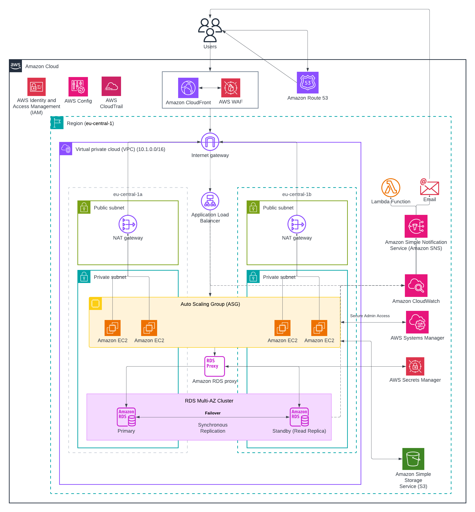

# High Availability and Security Two-Tier Web Application on AWS

## Introduction
In this Project, I build a fully-functional two-tier architecture for a web application on AWS. As can be seen from the architecture diagram (`TwoTierApplication.png`), this architecture is designed for being **highly available**, fault-tolerant, and **secure**. This architecture contains use of multiple Availability Zones with heavy limitation on internet traffic to the backend.

## Architecture Diagram

This architecture receives traffic from the edge using DNS and CDN services, passes them through WAF and distributes the load among auto-scaling instances in the private network using loadbalancer. The state is kept in a highly-available, multi-AZ relational database.

## AWS Services Used and Explanation of Why I Am Using Them

### 1. Edge, Networking, & Content Delivery
*   **Amazon Route53:** A highly available and scalable DNS service for routing web requests. It translates the human-friendly domain name into **CloudFront distribution's IP addresses** and can be used later for fail-over scenarios.
*   **Amazon CloudFront:** used as CDN service to serve cached copies of the content closer to the users, which helps in decreasing latency and offloading for the backend compute tier.
*   **AWS WAF (Web Application Firewall):** Connected to CloudFront, is used to protects applications from common web exploits (SQL injection, Cross-Site Scripting attacks, etc.) even before the traffic reaches the VPC.
*   **Amazon VPC (Virtual Private Cloud):** used to provide isolated network (10.1.0.0/16 in `eu-central-1`) for deployment of AWS resources . (10.1.0.0/16 is used to not overlap with future networks for S2S and peering purposes)
*   **Subnets:** four subnets where used, two subnets in each Az to provide Highly available architecture. a public and private subnets where used to isolate publicly accessed resources from isolated private resouces to provide a secure solution.  
*   **Internet Gateway (IGW):** used for establishing connection between VPC and the Internet for AWS resources in public subnets.
*   **NAT Gateway:** Placed in public subnets, to allow EC2 instances in private subnets to communicate with the Internet (ex: Patching / updates ) while preventing any ingress traffic from the Internet(can be enforced by using security groups).

### 2. Compute & Load Balancing
*   **Application Load Balancer (ALB):** Sits in the public subnets and balances HTTP/HTTPS traffic across ASG of EC2 instances in both Availability Zones, preventing any point of failure.
*   **Auto Scaling Group (ASG):** Manages adding or removing EC2 instances according to different conditions (for example, CPU usage as this is a compute intensive web application). That helps ensure a good performance and cost-efficiency.
*   **Amazon EC2 (Elastic Compute Cloud):** The actual virtual servers that host the backend application code. placed only in the private subnets and have only connection to the internet through Nat Gateway and it's egress only.

### 3. Database Tier
*   **Amazon RDS Multi-AZ Cluster:** A managed relational database with Primary and Standby (Read Replica) in different Availability Zones. There is synchronous replication that guarantees data availability, and automatic failover in case of the Primary instance failure.
*   **Amazon RDS Proxy:** The middleware between EC2 servers and RDS database that pools. will help saving database CPU power by limiting connections to RDS and perform failovers in multi-AZ databases up to 66% faster while not closing connections to the application.

### 4. Security & Management
*   **AWS Systems Manager (SSM) / Session Manager:** act as Bastion Host thats Offers secure and auditable access to the EC2 instances without having to open any inbound SSH ports (Port 22).
*   **AWS Secrets Manager:** It securely stores and manages the database credentials that are accessed by the EC2 instances in runtime through IAM roles.
*   **AWS IAM (Identity and Access Management):** used to provide all the access control across users, groups and roles (for example role that is used by EC2 to access AWS Secrets Manager)
*   **AWS Config:** Consistently audits the configurations of the AWS resources.(used to ensure no SSH access is configured on EC2 and also used to ensure that all resources are encypted at rest)
*   **AWS CloudTrail:** Keeps a log of all the API calls within the AWS account for auditing/accounting purposes.

### 5. Monitoring, Storage, and Notifications
*   **Amazon CloudWatch:** Used to Capture log data, metrics, and events from the EC2 instances, ALB, and RDS. Sends an alarm based on predetermined thresholds (such as scaling up the ASG) so that we're aware any action taken.
*   **Amazon SNS (Simple Notification Service):** A publish/subscribe messaging system that is used here for broadcasting alerts fired by CloudWatch to the administrators.
*   **AWS Lambda:** The serverless compute triggered by SNS to automate remediation activities (such as automatic restarting of failed services or custom alert messages formatting).
*   **Amazon S3 (Simple Storage Service):** Used as object storage for storing backups, images and videos used by the web application.

## Deployment Strategy
For easy and repeatable deployment, my advise to use infrastructure automation tools, like **AWS CloudFormation** and **Terraform**, instead of manual provisioning through AWS Management Console.
